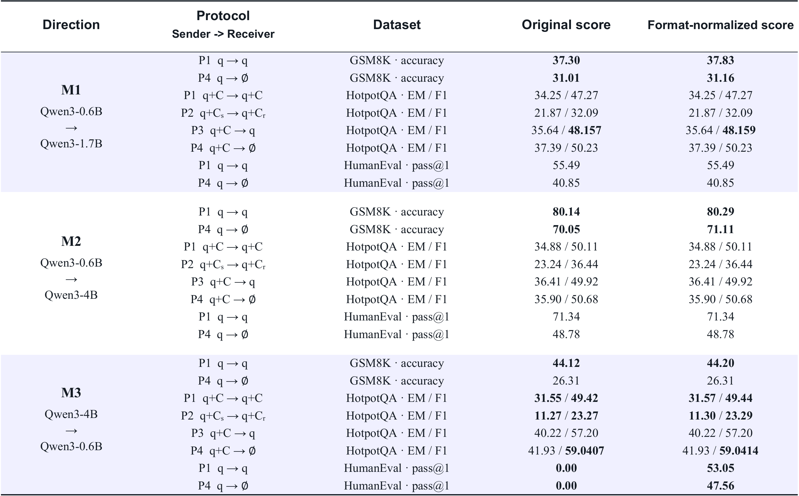
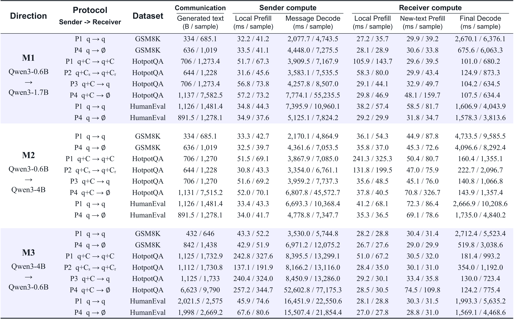
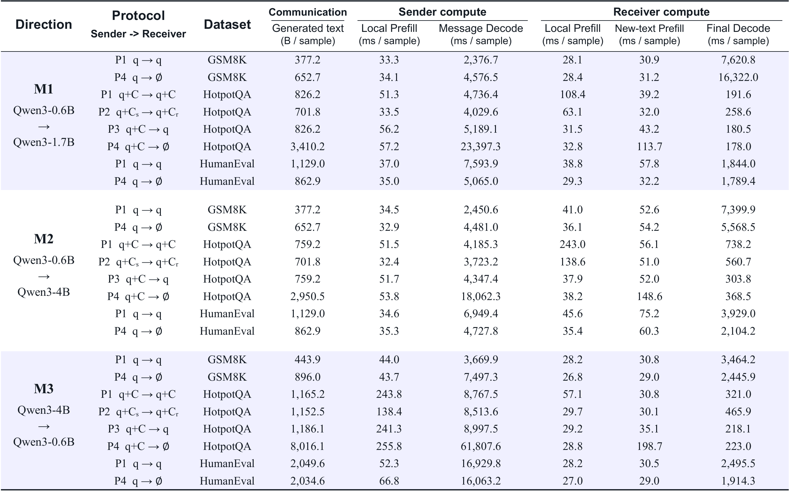
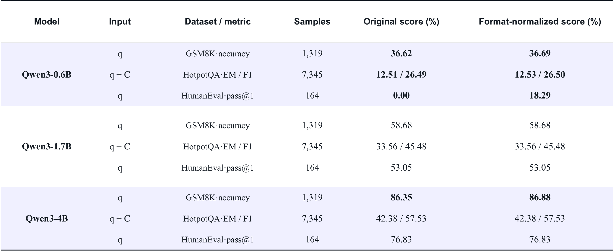
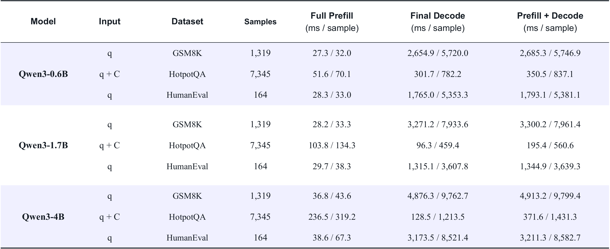
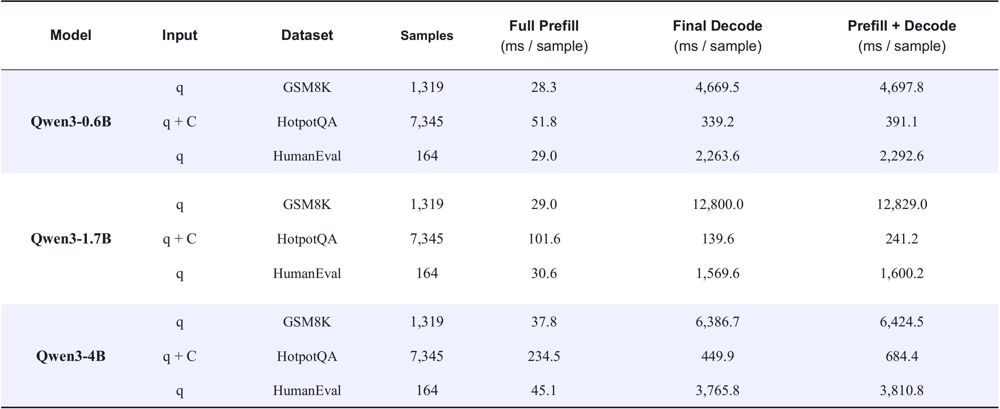

# T2T Text Communication Baseline

[](pyproject.toml)
[](requirements.lock.txt)
[](LICENSE)

**[中文说明](README.md) | [English Description](README.en.md)**

This repository provides reproduction code, final frozen prompts, and results for a T2T text communication baseline. It evaluates 24 conditions across three Qwen3 Sender→Receiver model directions on mathematical reasoning, question answering, and code generation, reporting original and format-normalized answer quality, communication bytes, stage-level inference latency, and GPU memory usage. Evaluation uses [GSM8K](https://github.com/openai/grade-school-math), [HotpotQA](https://hotpotqa.github.io/), and [HumanEval](https://github.com/openai/human-eval), retaining 97,578 communication outcomes plus 26,664 receiver-only outcomes across nine additional single-model control conditions: 124,242 outcomes in total.

## Contents

- [Experimental setup](#experimental-setup)
- [Results](#results)
- [Quick start](#quick-start)
- [Documentation](#documentation)
- [Datasets and third-party notices](#datasets-and-third-party-notices)

## Experimental setup

- **M1**: Qwen3-0.6B → Qwen3-1.7B
- **M2**: Qwen3-0.6B → Qwen3-4B
- **M3**: Qwen3-4B → Qwen3-0.6B

Each task shares the same final prompt across M1–M3. The four protocols differ in the information available locally at each endpoint:

<table border="1" cellspacing="0" cellpadding="8" style="border-collapse: collapse; width: 100%; border: 1px solid #d0d7de;">
  <thead>
    <tr>
      <th align="center" style="border: 1px solid #d0d7de; padding: 8px 12px;">Protocol</th>
      <th align="left" style="border: 1px solid #d0d7de; padding: 8px 12px;">Sender local information</th>
      <th align="left" style="border: 1px solid #d0d7de; padding: 8px 12px;">Receiver local information</th>
      <th align="left" style="border: 1px solid #d0d7de; padding: 8px 12px;">Applicable tasks</th>
    </tr>
  </thead>
  <tbody>
    <tr>
      <td align="center" style="border: 1px solid #d0d7de; padding: 8px 12px;"><strong>P1</strong></td>
      <td align="left" style="border: 1px solid #d0d7de; padding: 8px 12px;">Q + C</td>
      <td align="left" style="border: 1px solid #d0d7de; padding: 8px 12px;">Q + C</td>
      <td align="left" style="border: 1px solid #d0d7de; padding: 8px 12px;">GSM8K, HotpotQA, HumanEval</td>
    </tr>
    <tr>
      <td align="center" style="border: 1px solid #d0d7de; padding: 8px 12px;"><strong>P2</strong></td>
      <td align="left" style="border: 1px solid #d0d7de; padding: 8px 12px;">Q + Cₛ</td>
      <td align="left" style="border: 1px solid #d0d7de; padding: 8px 12px;">Q + Cᵣ</td>
      <td align="left" style="border: 1px solid #d0d7de; padding: 8px 12px;">HotpotQA</td>
    </tr>
    <tr>
      <td align="center" style="border: 1px solid #d0d7de; padding: 8px 12px;"><strong>P3</strong></td>
      <td align="left" style="border: 1px solid #d0d7de; padding: 8px 12px;">Q + C</td>
      <td align="left" style="border: 1px solid #d0d7de; padding: 8px 12px;">Q</td>
      <td align="left" style="border: 1px solid #d0d7de; padding: 8px 12px;">HotpotQA</td>
    </tr>
    <tr>
      <td align="center" style="border: 1px solid #d0d7de; padding: 8px 12px;"><strong>P4</strong></td>
      <td align="left" style="border: 1px solid #d0d7de; padding: 8px 12px;">Q + C</td>
      <td align="left" style="border: 1px solid #d0d7de; padding: 8px 12px;">∅ (fixed instructions only)</td>
      <td align="left" style="border: 1px solid #d0d7de; padding: 8px 12px;">GSM8K, HotpotQA, HumanEval</td>
    </tr>
  </tbody>
</table>

Q is the original question or complete function prefix; C is the complete evidence; Cₛ/Cᵣ are additional evidence held at each endpoint. GSM8K and HumanEval have no additional evidence. In every protocol, Sender generates analysis for Receiver; P4 also requires Sender to restate Q verbatim in the communication.

Runtime setup: one RTX 3090, both models resident, BF16/SDPA, batch 1, seed 42, thinking disabled, and greedy decoding. See the [experiment guide](docs/en/experiment.md) for protocols and complete prompts.

Independent single-model controls additionally evaluate Qwen3-0.6B, 1.7B, and 4B on all three tasks: nine conditions. Inputs are Q for mathematics, Q+C for QA, and the original function prefix Q for code. Each model uses one complete prefill, with no Sender and zero communication bytes. Each task shares the frozen `receiver_only_v1` prompt across models. These controls have a separate configuration from the 24 communication conditions.

## Results

There are 24 conditions and 97,578 outcomes. OOM and capacity failures receive zero quality scores in fixed denominators. HotpotQA comparisons use the common 7,345-question subset.

### Table 1. Original and format-normalized scores



### Table 2. Communication and stage-level latency (P50 / P95)



### Table 3. Communication and stage-level latency (arithmetic means)



[Original summary and confidence intervals](results/summary.csv)

### Receiver-only single-model controls

All 26,664 outcomes across nine conditions are complete, with no OOM or capacity failures. The tables use the common 7,345 HotpotQA tasks; the [full-precision summary](results/receiver_only/summary.csv) also retains all 7,405 HotpotQA tasks.

#### Table R1. Original and format-normalized scores



#### Table R2. Compute latency (P50 / P95)



#### Table R3. Compute latency (arithmetic means)



## Quick start

Use Linux, Python 3.11, a CUDA 12.8-compatible driver, and bubblewrap. Keep models and datasets outside the repository.

```bash
python -m pip install -r requirements.lock.txt
python -m pip install --no-deps -e .
cp configs/paths.example.json configs/paths.local.json
```

Configure external paths, prepare the data, and run. By default, the first CUDA device visible in the current environment is used.

```bash
t2t-experiments --config configs/experiment.json prepare
t2t-experiments --config configs/experiment.json run \
  --direction M1 --wait-memory --tmux t2t_m1 \
  --output /srv/t2t/runs/m1
```

[Full installation, resume, and scoring instructions](docs/en/usage.md)

[Receiver-only reproduction](docs/en/receiver_only.md)

## Documentation

- [Overview](reports/en/overview.md)
- [Experiment](docs/en/experiment.md)
- [Usage](docs/en/usage.md)
- [Results](docs/en/results.md)
- [Summary](results/summary.csv)

## Datasets and third-party notices

- [GSM8K — Training Verifiers to Solve Math Word Problems](https://github.com/openai/grade-school-math): main / test, 1,319.
- [HotpotQA — A Dataset for Diverse, Explainable Multi-hop Question Answering](https://hotpotqa.github.io/): distractor / dev, 7,405; common subset 7,345.
- [HumanEval — Evaluating Large Language Models Trained on Code](https://github.com/openai/human-eval): original / test, 164.

Model and dataset revisions are recorded in `configs/models.json` and `configs/experiment.json`. Project code is licensed under the [MIT License](LICENSE). See [NOTICE](third_party/NOTICE.md) for third-party attribution.
