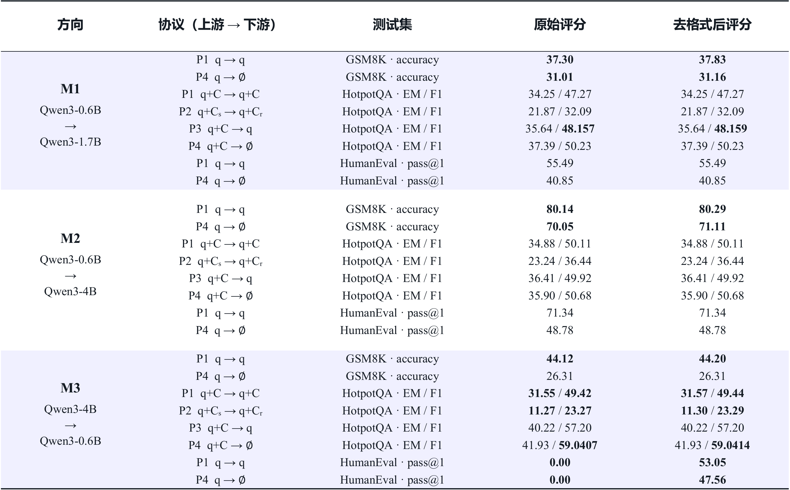
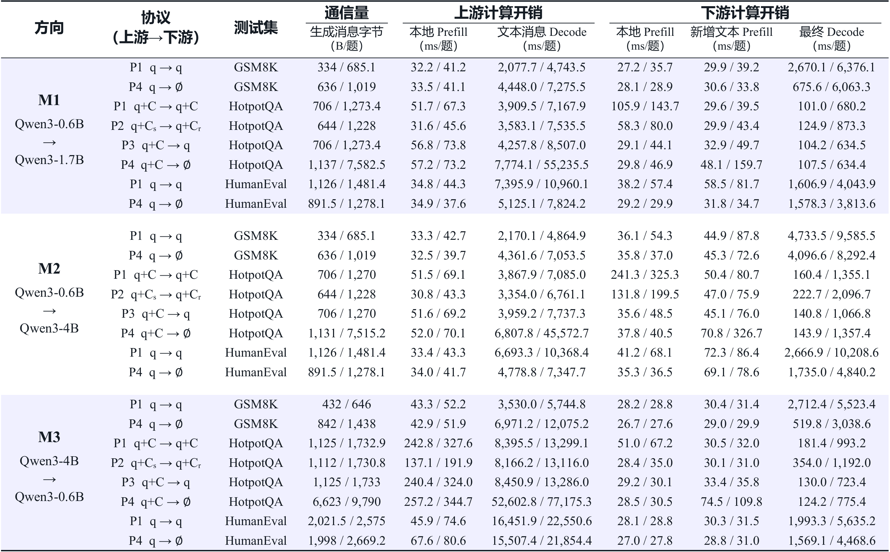
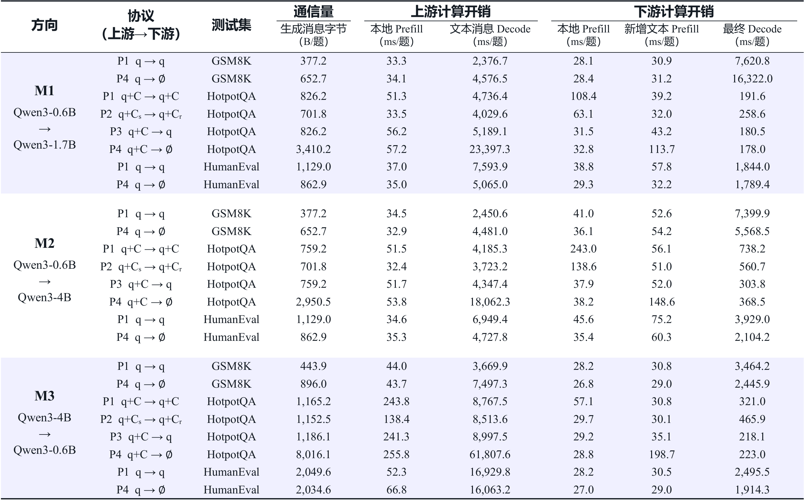
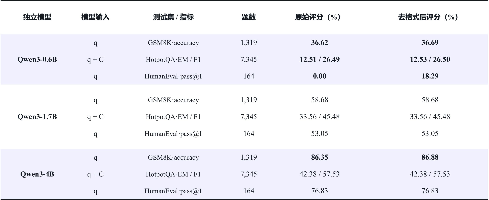
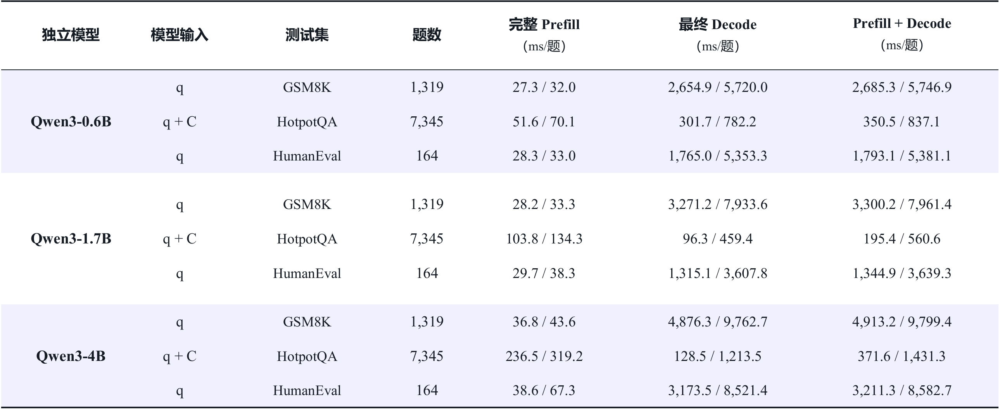
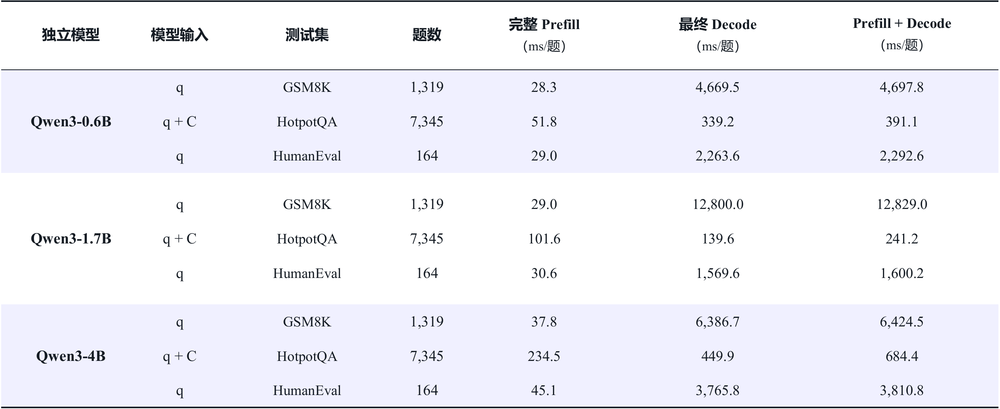

# T2T 文本通信基线实验

[](pyproject.toml)
[](requirements.lock.txt)
[](LICENSE)

**[中文说明](README.md) | [English Description](README.en.md)**

本仓库提供 T2T 文本通信基线的复现代码、最终冻结提示词和实验结果。在三组 Qwen3 Sender→Receiver 模型方向上，围绕数学推理、问答和代码生成任务开展24条件实验，统计原始及去格式后答案质量、通信字节量、分阶段推理时延与显存开销。评测采用 [GSM8K](https://github.com/openai/grade-school-math)、[HotpotQA](https://hotpotqa.github.io/) 和 [HumanEval](https://github.com/openai/human-eval)，通信实验保留97,578条逐题实验指标；另提供9条件、26,664条 receiver-only 单模型对照结果，两类实验共124,242条记录。

## 目录

- [实验设置](#实验设置)
- [测试结果](#测试结果)
- [快速开始](#快速开始)
- [文档](#文档)
- [数据集引用与第三方说明](#数据集引用与第三方说明)

## 实验设置

- **M1**: Qwen3-0.6B → Qwen3-1.7B
- **M2**: Qwen3-0.6B → Qwen3-4B
- **M3**: Qwen3-4B → Qwen3-0.6B

同一任务的最终提示词跨 M1–M3 共享，四种协议按两端可见信息设置如下：

<table border="1" cellspacing="0" cellpadding="8" style="border-collapse: collapse; width: 100%; border: 1px solid #d0d7de;">
  <thead>
    <tr>
      <th align="center" style="border: 1px solid #d0d7de; padding: 8px 12px;">协议</th>
      <th align="left" style="border: 1px solid #d0d7de; padding: 8px 12px;">Sender 本地信息</th>
      <th align="left" style="border: 1px solid #d0d7de; padding: 8px 12px;">Receiver 本地信息</th>
      <th align="left" style="border: 1px solid #d0d7de; padding: 8px 12px;">适用任务</th>
    </tr>
  </thead>
  <tbody>
    <tr>
      <td align="center" style="border: 1px solid #d0d7de; padding: 8px 12px;"><strong>P1</strong></td>
      <td align="left" style="border: 1px solid #d0d7de; padding: 8px 12px;">Q + C</td>
      <td align="left" style="border: 1px solid #d0d7de; padding: 8px 12px;">Q + C</td>
      <td align="left" style="border: 1px solid #d0d7de; padding: 8px 12px;">GSM8K、HotpotQA、HumanEval</td>
    </tr>
    <tr>
      <td align="center" style="border: 1px solid #d0d7de; padding: 8px 12px;"><strong>P2</strong></td>
      <td align="left" style="border: 1px solid #d0d7de; padding: 8px 12px;">Q + Cₛ</td>
      <td align="left" style="border: 1px solid #d0d7de; padding: 8px 12px;">Q + Cᵣ</td>
      <td align="left" style="border: 1px solid #d0d7de; padding: 8px 12px;">HotpotQA</td>
    </tr>
    <tr>
      <td align="center" style="border: 1px solid #d0d7de; padding: 8px 12px;"><strong>P3</strong></td>
      <td align="left" style="border: 1px solid #d0d7de; padding: 8px 12px;">Q + C</td>
      <td align="left" style="border: 1px solid #d0d7de; padding: 8px 12px;">Q</td>
      <td align="left" style="border: 1px solid #d0d7de; padding: 8px 12px;">HotpotQA</td>
    </tr>
    <tr>
      <td align="center" style="border: 1px solid #d0d7de; padding: 8px 12px;"><strong>P4</strong></td>
      <td align="left" style="border: 1px solid #d0d7de; padding: 8px 12px;">Q + C</td>
      <td align="left" style="border: 1px solid #d0d7de; padding: 8px 12px;">∅（仅固定指令）</td>
      <td align="left" style="border: 1px solid #d0d7de; padding: 8px 12px;">GSM8K、HotpotQA、HumanEval</td>
    </tr>
  </tbody>
</table>

Q 为原题或完整函数前缀，C 为完整证据，Cₛ/Cᵣ 为两端分持的额外证据；GSM8K、HumanEval 不含额外证据。所有协议均由 Sender 生成分析并传给 Receiver；P4 还要求 Sender 在通信中逐字复述 Q。

运行设置：单张 RTX 3090、双模型常驻、BF16/SDPA、batch 1、seed 42、关闭 thinking、贪心解码。完整协议及模板见[实验说明](docs/zh-CN/experiment.md)。

独立单模型对照另外评测 Qwen3-0.6B、1.7B、4B，每模型覆盖三个任务，共 9 条件。数学输入 Q，问答输入 Q+C，代码输入原始函数前缀 Q；一次完整 Prefill，无 Sender，通信字节量为 0。同一任务共享 `receiver_only_v1` 提示词。单模型对照与上述 24 条通信条件分别配置和运行。

## 测试结果

共24条件、97,578条记录；OOM与容量失败计入质量指标的固定分母并赋零分。HotpotQA 的跨协议表格采用共同7,345题。

### 表 1. 原始评分与去格式后评分



### 表 2. 通信量与分阶段计算时延（P50 / P95）



### 表 3. 通信量与分阶段计算时延（算术均值）



[原始汇总及置信区间](results/summary.csv)

### Receiver-only 单模型对照

9 条件、26,664 题次全部完成，OOM 与容量失败均为 0。以下三表使用 HotpotQA 共同 7,345 题；[完整精度汇总](results/receiver_only/summary.csv)同时保留全量 7,405 题统计。

#### 表 R1. 原始评分与去格式后评分



#### 表 R2. 计算时延（P50 / P95）



#### 表 R3. 计算时延（算术均值）



## 快速开始

使用 Linux Python 3.11 环境、兼容 CUDA 12.8 的驱动及 bubblewrap；模型与数据集存放在仓库外。

```bash
python -m pip install -r requirements.lock.txt
python -m pip install --no-deps -e .
cp configs/paths.example.json configs/paths.local.json
```

配置外部路径后准备数据并运行；默认使用当前环境中的第一张可见 CUDA 设备。

```bash
t2t-experiments --config configs/experiment.json prepare
t2t-experiments --config configs/experiment.json run \
  --direction M1 --wait-memory --tmux t2t_m1 \
  --output /srv/t2t/runs/m1
```

[完整安装、续跑与评分步骤](docs/zh-CN/usage.md) · [Receiver-only 复现](docs/zh-CN/receiver_only.md)

## 文档

- [Overview](reports/zh-CN/overview.md)
- [Experiment](docs/zh-CN/experiment.md)
- [Usage](docs/zh-CN/usage.md)
- [Results](docs/zh-CN/results.md)
- [Summary](results/summary.csv)

## 数据集引用与第三方说明

- [GSM8K — Training Verifiers to Solve Math Word Problems](https://github.com/openai/grade-school-math): main / test, 1,319.
- [HotpotQA — A Dataset for Diverse, Explainable Multi-hop Question Answering](https://hotpotqa.github.io/): distractor / dev, 7,405; common subset 7,345.
- [HumanEval — Evaluating Large Language Models Trained on Code](https://github.com/openai/human-eval): original / test, 164.

模型和数据版本见 `configs/models.json`、`configs/experiment.json`。项目代码采用 [MIT 开源协议](LICENSE)，第三方说明见 [NOTICE](third_party/NOTICE.md)。
