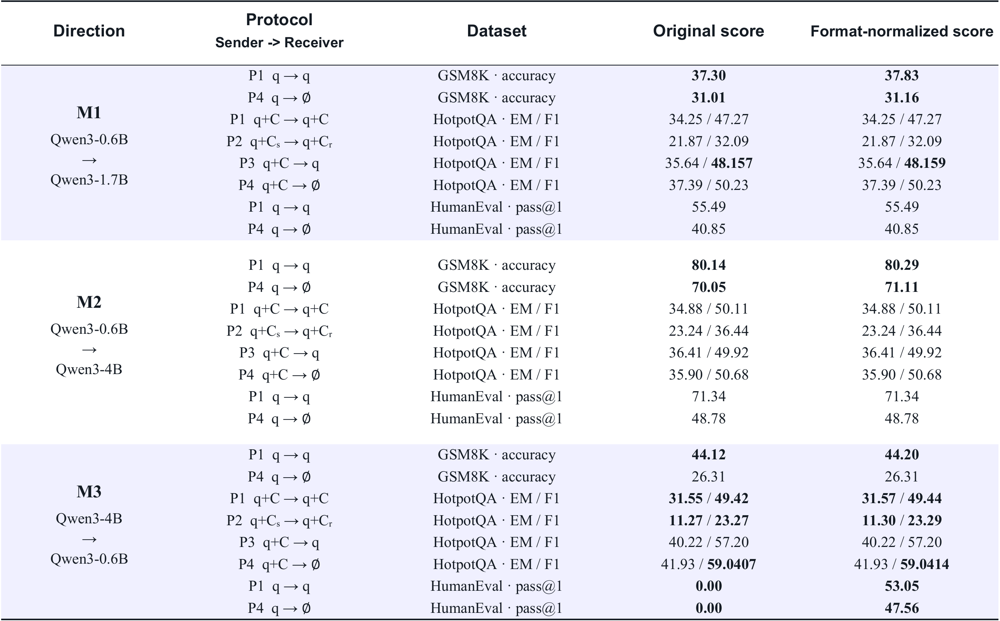
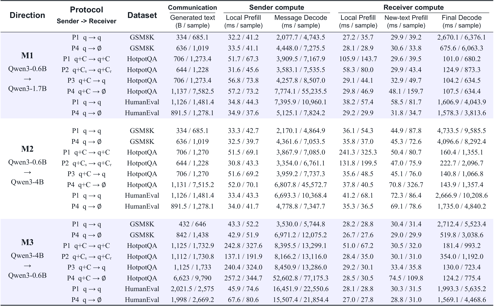
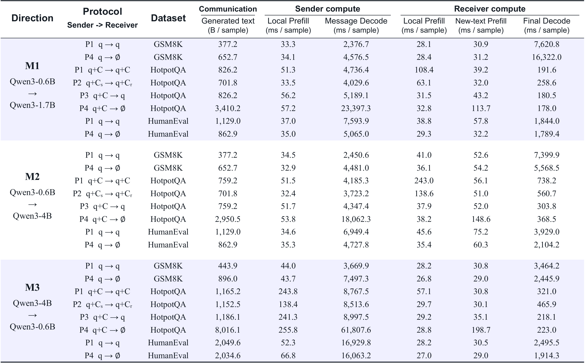
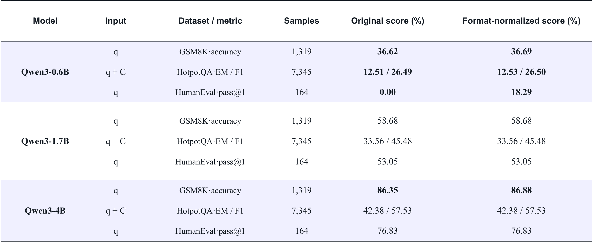
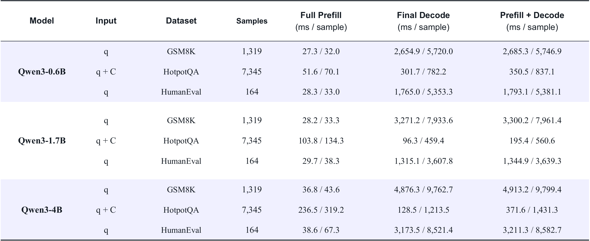
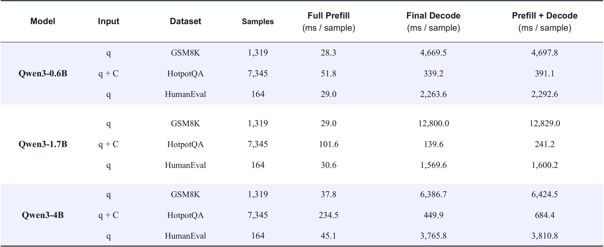

# T2T text communication baseline overview

## 1. Setup

Final task prompts are shared across Qwen3 directions M1 (0.6B→1.7B), M2 (0.6B→4B) and M3 (4B→0.6B). GSM8K and HumanEval use P1/P4; HotpotQA uses P1–P4, giving 24 conditions. Sender is executed in all conditions. P4 requires Sender to restate the complete task; the program does not separately provide the question to Receiver.

One RTX 3090, both models resident, BF16/SDPA, batch 1, seed 42, thinking disabled and greedy decoding. Task metrics are accuracy, EM/F1 and pass@1.

## 2. Coverage and failures

| Direction | Outcomes | Normal generations | OOM | Capacity failures |
|---|---:|---:|---:|---:|
| M1 | 32,526 | 32,512 | 0 | 14 |
| M2 | 32,526 | 32,482 | 30 | 14 |
| M3 | 32,526 | 32,430 | 75 | 21 |
| Total | 97,578 | 97,424 | 105 | 49 |

Complete coverage does not mean every sample generated normally. OOM/capacity failures receive zero scores in fixed denominators. Table 1 reports original and format-normalized quality scores in percent; Tables 2 and 3 report communication and latency in the units shown in their column headers. HotpotQA uses the common 7,345 tasks for matched protocol comparisons.

## 3. Results

### Table 1. Original and format-normalized scores

### Table 2. Communication and stage-level latency (P50 / P95)

### Table 3. Communication and stage-level latency (arithmetic means)

These are descriptive comparisons for the tested model pairs, templates and datasets; no new significance tests were performed.

[Original summary and confidence intervals](../../results/summary.csv)

## 4. Receiver-only single-model controls

Independent single-model controls additionally evaluate Qwen3-0.6B, 1.7B, and 4B on all three tasks: nine conditions. Inputs are Q for mathematics, Q+C for QA, and the original function prefix Q for code. Each model uses one complete prefill, with no Sender and zero communication bytes. Each task shares the frozen `receiver_only_v1` prompt across models. These controls have a separate configuration from the 24 communication conditions.

All 26,664 outcomes completed without OOM or capacity failures. Tables use common HotpotQA 7,345; the [separate summary](../../results/receiver_only/summary.csv) also retains all 7,405 tasks.

### Table R1. Original and format-normalized scores

### Table R2. Compute latency (P50 / P95)

### Table R3. Compute latency (arithmetic means)

[Reproduction, scoring, and comparison scope](../../docs/en/receiver_only.md). M1/M2/M3 map to R17/R40/R06; full/split prefill and single/dual-model memory scopes differ.
