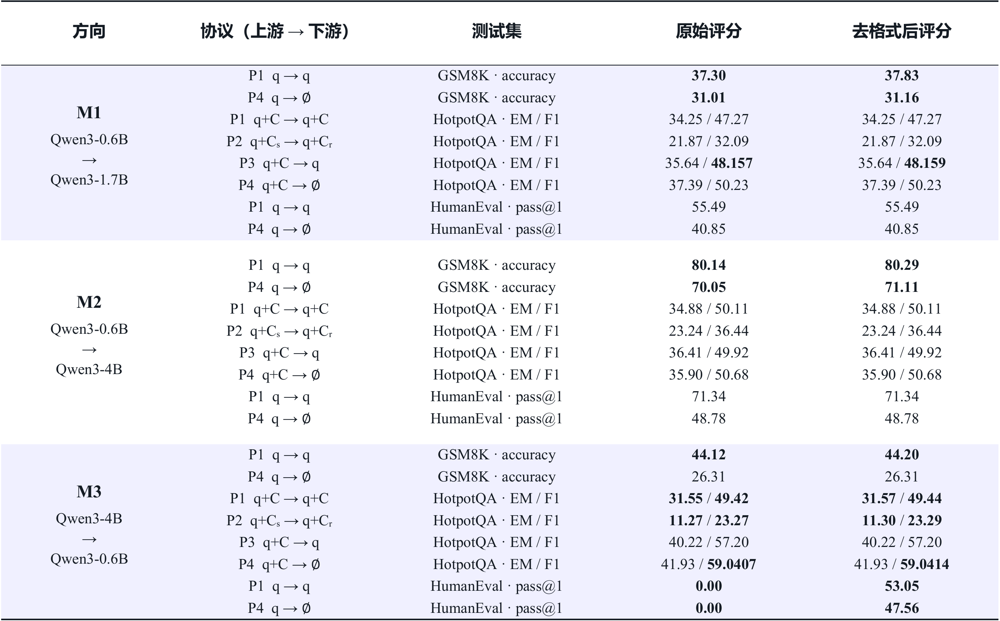
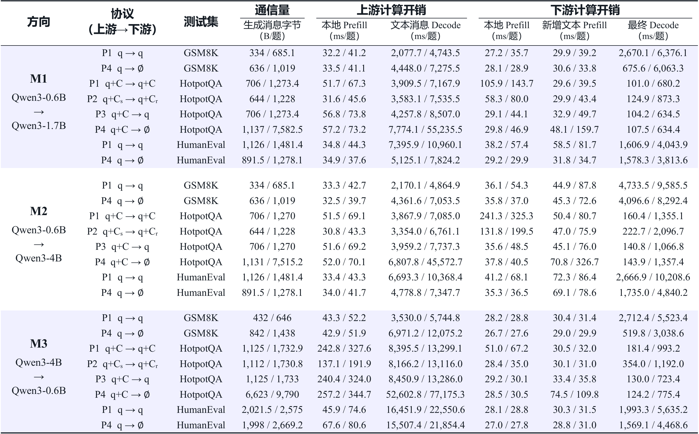
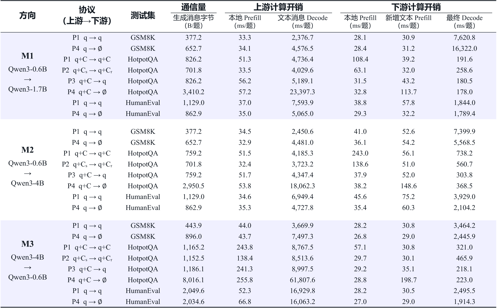

# T2T 文本通信基线实验综述

## 1. 实验概况

最终冻结模板在 M1（0.6B→1.7B）、M2（0.6B→4B）、M3（4B→0.6B）间共享，模型均为 Qwen3。GSM8K 与 HumanEval 使用 P1/P4，HotpotQA 使用 P1–P4，共 24 条件。所有条件调用 Sender；P4 由 Sender 在通信中逐字复述任务，Receiver 不从程序另获原问题。

单张 RTX 3090、双模型常驻、BF16/SDPA、batch 1、seed 42、关闭 thinking、贪心解码。数学、问答与代码分别使用 accuracy、EM/F1、pass@1。

## 2. 覆盖与失败情况

| 方向 | 总样本 | 正常生成 | OOM | 容量失败 |
|---|---:|---:|---:|---:|
| M1 | 32,526 | 32,512 | 0 | 14 |
| M2 | 32,526 | 32,482 | 30 | 14 |
| M3 | 32,526 | 32,430 | 75 | 21 |
| Total | 97,578 | 97,424 | 105 | 49 |

覆盖完整不等于所有样本都正常生成。OOM/容量失败按既定规则计入固定分母并赋零分。表1展示原始与去格式后质量评分，单位为百分比；表2、表3展示通信量与时延，单位见列名。HotpotQA 使用共同 7,345 题以支持跨协议比较。

## 3. 测试结果

### 表 1. 原始评分与去格式后评分

### 表 2. 通信量与分阶段计算时延（P50 / P95）

### 表 3. 通信量与分阶段计算时延（算术均值）

这些结果只支持当前模型对、模板与评测集合下的描述性比较，未进行新的显著性检验。

[原始汇总及置信区间](../../results/summary.csv)
